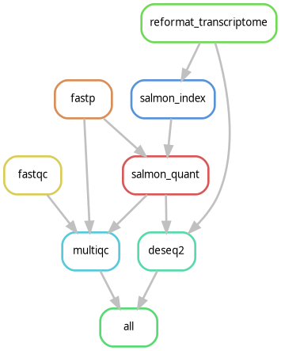

# RNA-seq Differential Expression Pipeline

A Snakemake pipeline for RNA-seq differential expression analysis of the
airway smooth muscle dataset (GEO [GSE52778](https://www.ncbi.nlm.nih.gov/geo/query/acc.cgi?acc=GSE52778)) used in [Himes et al. (2014)](https://journals.plos.org/plosone/article?id=10.1371/journal.pone.0099625).
The dataset has four donors and the `untreated`/`Dex` (dexamethasone)
groups are used for analysis.


## Results
Himes et al. (2014) reported 316 differentially expressed genes using Cuffdiff 2.0.2 without accounting for donor pairing. This project used DeSeq2 with a donor-paired design and found ~3600 differentially expressed genes (padj < 0.05) between the treated (dexamethasone) and untreated conditions. In both analyses, CRISPLD2 is found to be upregulated by dexamethasone.


## Project layout

```
rna-differential-expression/
├── config/
│   └── config.yaml                 # project settings
├── data/
│   ├── metadata.csv                # metadata of samples
│   ├── samples.tsv                 # samples (created by create_sample_list.py)
│   ├── reads/                      # raw FASTQ files
│   └── ref/
│       ├── gencode.v44.transcripts.fa.gz   # raw GENCODE transcriptome
│       ├── transcriptome.fa.gz             # shortened headers to transcript ids only
│       └── tx2gene.tsv                     # mapped transcript ids to gene symbols
├── envs/
│   ├── environment.yaml            # main conda environment
│   ├── qc.yaml                     # rules fastqc, fastp, and multiqc
│   ├── salmon.yaml                 # rules salmon_index and salmon_quant
│   └── deseq2.yaml                 # rule deseq2
├── workflow/
│   ├── Snakefile                   # workflow entry point
│   ├── rules/
│   │   ├── ref.smk                 # rule reformat_transcriptome
│   │   ├── qc.smk                  # rules fastqc, fastp, and multiqc
│   │   ├── quant.smk               # rules salmon_index and salmon_quant
│   │   └── deseq2.smk              # rule deseq2
│   └── scripts/
│       ├── download_fastq.sh
│       ├── create_sample_list.py
│       ├── reformat_transcriptome.py
│       └── run_deseq2.R
├── results/                        # outputs generated by pipeline
│   ├── qc/                         # fastqc and fastp reports
│   ├── salmon_index/
│   ├── quant/<sample>/quant.sf
│   ├── deseq2/                     # results.tsv, significant_genes.tsv, plots, validation.txt
│   └── multiqc/multiqc_report.html
├── logs/                           # logs generated by pipeline
├── rulegraph.png
└── README.md
```

`data/metadata.csv` (`GSM,sample_id,SRR` per line without header), which is included in the repository, was
manually collated from GEO as follows:

1. Go to the [GSE52778 series page](https://www.ncbi.nlm.nih.gov/geo/query/acc.cgi?acc=GSE52778).
2. Scroll to "Samples (16)" and click a GSM (e.g. `GSM1275862`).
3. Under "Relations", click the SRA link (e.g. `SRX384345`).
4. The run accession is in the "Runs" column of the "Runs" table.


## Pipeline overview



**1.** fastqc:
- Produces per-base quality, per-sequence quality, GC content, and duplication levels on raw paired-end reads

**2.** fastp:
- Trims adapters from raw reads

**3.** reformat_transcriptome:
- Shortens each header in raw transcriptome FASTA to transcript id and saves file as `transcriptome.fa.gz`
- Creates file `tx2gene.tsv` which maps transcript ids to gene symbols

**4.** salmon index:
- Builds a k-mer index (k = 31) from reference transcriptome

**5.** salmon quant:
- Maps trimmed reads to index (`--validateMappings`) and corrects for GC bias (`--gcBias`)
- Writes `quant.sf` that has one row per transcript with estimated abundance

**6.** deseq2:
- Collapses transcript-level abundance to gene-level counts in `quant.sf` files
- Removes genes if the total gene count across all 8 samples is 10 or less
- Fits the model with design `~donor + condition`
- Normalizes gene-level counts and estimates dispersion
- Conducts Wald significance test
- Outputs `results.tsv`, `significant_genes.tsv` (padj < 0.05 and |log2FC| > 1), `ma_plot.png`, `pca_plot.png` and `validation.txt`, which checks that CRISPLD2 is significant

**7.** multiqc:
- Consolidates all fastqc, fastp, and Salmon logs/reports into a single HTML report


## Setup and usage

### 1. Clone project repository to the directory of your choice
```bash
cd <path/to/directory>
git clone https://github.com/egistific/rna_seq.git
```

### 2. Create and activate the main conda environment

```bash
conda env create -f envs/environment.yaml
conda activate rnaseq
```

### 3. Download the reference transcriptome

```bash
mkdir -p data/ref
curl -L "https://ftp.ebi.ac.uk/pub/databases/gencode/Gencode_human/release_44/gencode.v44.transcripts.fa.gz" \
  -o data/ref/gencode.v44.transcripts.fa.gz
```

### 4. Download the sample reads and save to the folder `data/reads`
```bash
bash workflow/scripts/download_fastq.sh
```

### 5. Build the sample list

```bash
python workflow/scripts/create_sample_list.py
```

### 6. Run the pipeline

```bash
snakemake -p --use-conda --conda-frontend conda --cores 4 --rerun-incomplete
```
--conda-frontend conda` is needed as only `conda` (not `mamba`) is
installed in `rnaseq` but `mamba` is used by Snakemake 8.4 to build environments. 

## TO DO
- Use decoy sequences in the Salmon index
